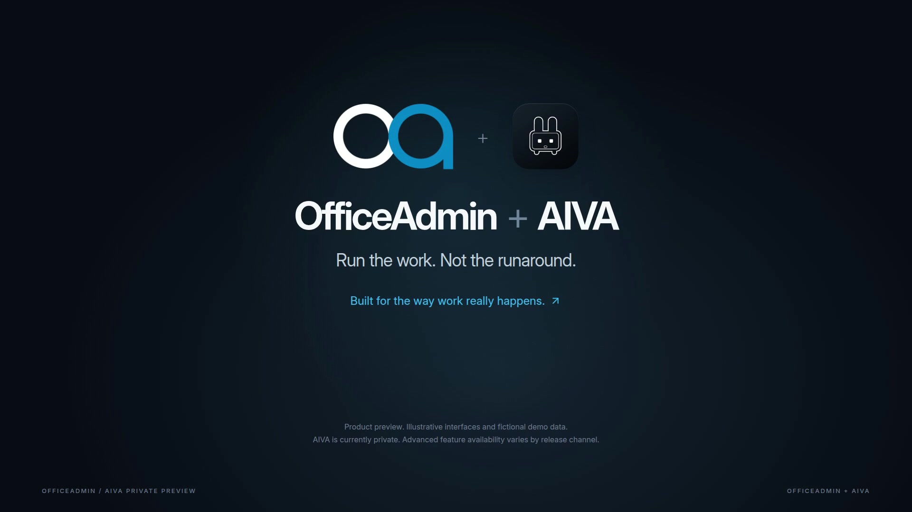

# OfficeAdmin + AIVA



**Watch the 112-second film:** [Download the full-HD film (MP4)](https://github.com/banddude/officeadmin-aiva-product-film/releases/download/v1.0.0/OfficeAdmin_AIVA_Product_Film.mp4).

This public repository contains the **complete editable Remotion film project**, product research, 78-entry feature-registry snapshot, original sound and narration stems, storyboard, render intermediates, complete QA checks, production scripts, and repeatable render instructions. The original Kokoro model weights are attached separately to Release v1.0.0 because of their size. This project is not the OfficeAdmin or AIVA application source repository and does not include credentials or customer data.

## Run the work. Not the runaround.

A 112-second, 1920 × 1080, 30 fps product film, built in React and Remotion 4.0.535. The project is editable, not a collection of flattened slides. Every animation is driven by the composition frame. Interface illustrations use fictional demo data and actual OfficeAdmin/AIVA brand assets.

### Open the project

Requirements: Node.js 22 or newer. FFmpeg and FFprobe are required by the resumable render script. The direct Remotion command uses Remotion's own rendering toolchain.

```sh
npm ci
npm run fonts
npm run studio
```

The font setup downloads Inter from its public upstream repository. Font binaries are deliberately omitted from this package. An internet connection is needed for dependency and font setup; the prepared film has no runtime calls to the OfficeAdmin app or any customer services.

### Render

```sh
npm run typecheck
npm run render
```

The production script renders four resumable, 28-second visual sections, then combines them with the finished soundtrack into `out/officeadmin-aiva-film.mp4`. All visuals are rendered by Remotion. FFmpeg joins the rendered sections, converts the browser-rendered full-range BT.601 imagery to a limited-range Rec.709 delivery master, and adds the audio master. The final delivery is H.264, yuv420p, Rec.709, 1080p, with AAC stereo audio and fast-start metadata.

To choose an installed browser or change rendering concurrency:

```sh
REMOTION_BROWSER=/path/to/chrome REMOTION_CONCURRENCY=2 npm run render
```

Without a browser override, the script uses the render host's Chromium where available or Remotion's browser selection. The production script deliberately resumes completed chunks. After changing the visuals, render into a fresh `out` directory or archive/remove the old `part-*.mp4` files so they are rebuilt. The non-resumable alternative is:

```sh
npm run render:direct
```

### Edit

`src/index.tsx` defines the composition, durations, and scene order. `src/design.tsx` contains reusable typography, brand marks, cards, illustration primitives, and easing. `src/scenes-core.tsx` covers the opening, workspace, and takeoff. `src/scenes-operations.tsx` covers estimating, customer approval, field time, and accounting. `src/scenes-aiva.tsx` covers AIVA, the recorded-conversation example, reviewed follow-up, and closing.

The soundtrack is `public/audio/master.wav`. `public/audio/narration.wav` and `public/audio/music-and-sound.wav` are separate stems. The numbered `vo-*.wav` files are the individual narration phrases. Use the included metadata and caption files to revise pacing.

### Production notes

Read `production/creative-direction.md` for the story, positioning, shot plan, and timing. `production/claims-and-provenance.md` records sources, demonstration limits, and audio provenance. The full research and the date-stamped feature registry are retained in `production/product-capability-map.md` and `production/feature-registry-snapshot.json`. The feature inventory is a historical research snapshot, **not** a promise that every alpha/beta capability is publicly available.

AIVA is shown as a private preview. Several adjacent features are alpha or beta. The film does not claim that all tenants can use them today, and it does not contain live customer information. No project, financial record, message, approval, invoice, or payment was changed to create this film.

This project was created as an original product film. It contains no Apple marks, copied Apple advertising, stock music, or impersonated human voice. The narration is synthetic, using a preset voice. Product marks remain their respective owners' property. See provenance notes for dependency and asset licensing considerations.
