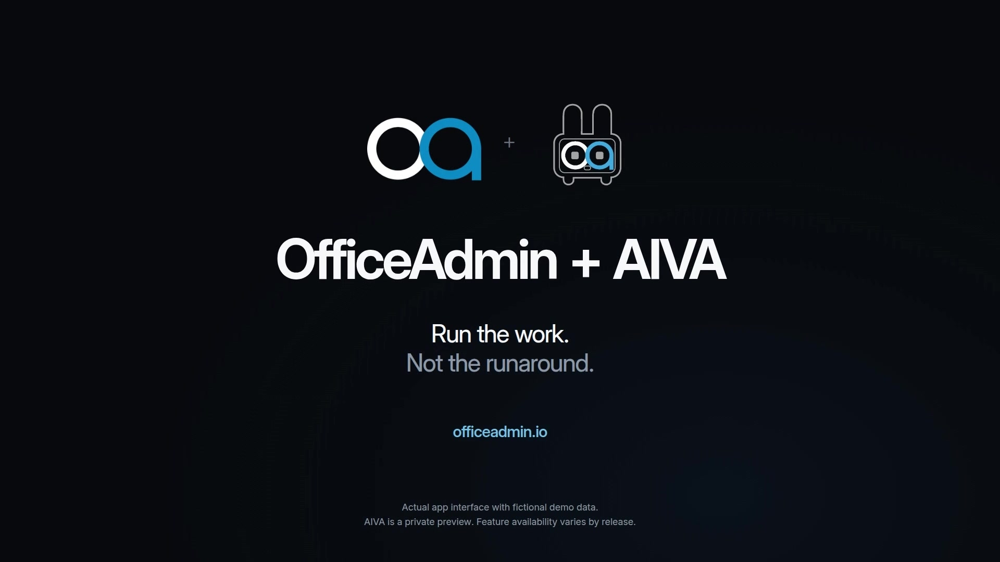

# OfficeAdmin + AIVA

## Run the work. Not the runaround.



**Version 2 is a 96-second product film, with a separately composed vertical reel.** The story introduces OfficeAdmin as one connected home for customers, projects and money, then introduces AIVA as an assistant with the context of that work.

[Watch the widescreen film](https://github.com/banddude/officeadmin-aiva-product-film/releases/download/v2.0.0/OfficeAdmin_AIVA_V2_Film.mp4) · [Watch the vertical reel](https://github.com/banddude/officeadmin-aiva-product-film/releases/download/v2.0.0/OfficeAdmin_AIVA_V2_Vertical.mp4) · [All release assets](https://github.com/banddude/officeadmin-aiva-product-film/releases/tag/v2.0.0)

### What changed

The interface illustrations are replaced by captures of **the actual application's client components and styles**, running in an isolated fixture environment. That includes the real sidebar, top bar, project list, estimate, invoice, accounting dashboard, AIVA desktop dock and mobile chat. These are **not authenticated production recordings**. All people, projects, amounts and messages shown are fictional demo data.

The AIVA mark now uses its complete official artwork, including the OfficeAdmin eyes and the application's exact theme colors. The OfficeAdmin mark is also the supplied asset, with only empty transparent canvas trimmed. The phone is a frame-driven, dimensional iPhone 17 Pro front study, with the responsive app capture inside its display rather than a made-up mobile interface.

The revised narration contains 105 words and approximately 35 seconds of speech. **AIVA is explicitly synthesized as “AY-vuh,” /ˈeɪvə/**. The original voice engine's reading of the spelling “Ava” was different; changing the written spelling alone did not solve it. The new, original 120 BPM score adds syncopation, bass and percussion, with space around the AIVA reveal and final promise.

Version 1 remains available in [its original release](https://github.com/banddude/officeadmin-aiva-product-film/releases/tag/v1.0.0). Its compositions, research, audio and production sources remain in this repository.

## Open and render

Node.js 22+, FFmpeg and FFprobe are required. Chromium is selected by Remotion when no compatible host browser override is supplied.

```sh
npm ci
npm run fonts
npm run typecheck
npm test
npm run studio
```

The font command retrieves Inter from its public upstream source. Font binaries are deliberately excluded from this repository and release packages.

```sh
npm run render
npm run render:vertical
```

The outputs are `out/v2/OfficeAdmin_AIVA_V2_Film.mp4` and `out/v2/OfficeAdmin_AIVA_V2_Vertical.mp4`. Both are 96 seconds, 30 fps, H.264/AAC, yuv420p and Rec.709, with fast-start metadata. Widescreen is 1920 × 1080; vertical is 1080 × 1920. The vertical layout is composed separately, not an automatic center crop.

The production renderer uses six resumable 16-second sections per aspect ratio. Its cache is keyed to the visual source and asset hashes, so changed visuals cannot silently reuse stale sections. Every completed delivery is fully decoded and checked for audio, dimensions, frame count and runtime.

```sh
# Render at most two missing sections per invocation, then safely resume.
node production/v2-render.mjs landscape --chunks=2
node production/v2-render.mjs portrait --chunks=2

# Optional host overrides.
REMOTION_BROWSER=/path/to/chrome REMOTION_CONCURRENCY=3 npm run render

# Contact-sheet source frames in both formats.
npm run review
```

Normal film rendering needs only this repository, its installed dependencies, the downloaded font, committed screenshots and the committed finished AAC soundtrack. It makes no calls to OfficeAdmin, AIVA, a customer service or a voice-generation API.

## Source map

`src/v2-index.tsx` registers the two delivery compositions and their silent review variants. `src/v2-film.tsx` contains the editorial structure, responsive layouts, camera moves, phone geometry and official brand placements. `public/ui/` contains the source-authentic demo captures. `public/brand/` contains the original and deterministically prepared official marks. `public/audio/v2/master.m4a` is the finished soundtrack used by the film.

`production/v2-audio.py` generates the new score and explicit-phoneme narration. `production/v2-narration.json` records the timed cues, phonemes and synthesis settings. The SRT and VTT caption files use the correct written product names. Lossless audio stems are preserved in the version 2 release rather than adding another large set of WAV blobs to Git.

`production/capture2/` contains the optional actual-source capture harness. It requires a compatible checkout of the OfficeAdmin application with its own dependencies. The recorded checkout revision is in `isolation-manifest.json`. The application's private compiled bundle, generated CSS, authentication state, databases and environment files are not distributed here.

```sh
OFFICEADMIN_SOURCE=/path/to/officeadmin-books npm run capture:build
OFFICEADMIN_SOURCE=/path/to/officeadmin-books \
  CAPTURE_BROWSER=/path/to/chromium npm run capture
```

The capture harness imports actual visible components and replaces only data/service boundaries and unopened dialogs. It binds to loopback, blocks outside requests, resolves demo reads in memory, and rejects all business mutations. It includes actual read-only invoice and dashboard scroll states. It is an optional production tool, not a deployable copy of the application.

## Accuracy and review

AIVA is identified as a **private preview**. The film does not promise universal assistant access, automatic payment after estimate acceptance, an automatically sent follow-up, autonomous pricing, tax compliance or guaranteed business results. The example assistant draft is explicitly unsent and ready for review.

`production/v2-production-notes.md` explains the cut, sources and boundaries. `qa/v2/capture2-results.json` records capture provenance, viewport sizes, zero-error checks, network isolation, mutation checks and screenshot hashes. `qa/v2/tests.json` records the 20 source/asset/audio checks. Delivery probe and visual-review records are retained alongside them.

The original research and feature-registry snapshot under `production/` are preserved as historical context, not a claim that every alpha/beta or owner-only feature is generally available. Product marks remain their owner's property. Refer to `NOTICE.md` and the provenance documents for dependency, model and licensing notes.

### Final delivery checks and Photos import

After both exports exist, `npm run test:delivery` checks full video/audio decoding, exact soundtrack packet identity, frame counts, Rec.709 tags, 96-second duration, stereo AAC, encoded loudness, true-peak headroom and fast-start metadata. The result is retained in `qa/v2/final-delivery-validation.json`.

On the Mac where Photos should receive the movies, run the following after copying and verifying both MP4 files. The script creates or reuses an album named `OfficeAdmin + AIVA - V2`, leaves duplicate checking enabled, and verifies each imported movie by filename and pixel dimensions. It does not delete or alter unrelated media.

```sh
osascript production/import-v2-to-photos.applescript /absolute/path/to/delivery-folder
```

### Original compositions

Use `npm run studio:v1`, `npm run render:v1` or `npm run review:v1` for the original 112-second production. Version 2 is now the default.
